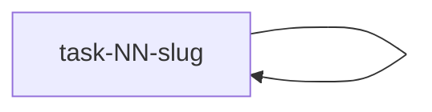

# {Goal name} — Plan

## Goal

{The major goal this plan reaches: what must be true when every task below is done, and who uses the result.}

## Design

{Link to the Ideation result, or to the caller's topic contract when Ideation did not run. Do not restate it.}

## Task Graph

{Show every task and label each dependency with the result or verified behavior the consumer needs.
Include dependencies across plan documents and identify the tasks that can run in parallel.}

## Verification

| When | Evidence needed | Work that depends on it |
|---|---|---|
| {task, integration, or final state} | {focused or shared check and the outcome it must show} | {dependent task, review point, or final acceptance} |

## Review Points

| Point | Covers | Why here |
|---|---|---|
| `review-NN` | {the task IDs delivered since the previous point} | {observable outcome and why feedback matters here, or final integrated Goal} |

{List the points that follow this plan's tasks. Write `None` and name the covering point when a point in
another plan document covers these tasks.}

## Tasks

### `task-NN-slug` — {Task title}

#### Goal

{What must be true when this task is done, and how a reviewer can tell. Add a number only when the user, an
accepted decision, or a project rule requires it, and name that source.}

#### Context

{Why this task exists and what the author cannot find alone: decisions already made and the state it starts
from.}

#### Constraints

- {A rule that must hold}: {its reason and source}

{Leave this section out when nothing must hold beyond the Goal.}

#### Taste and Preference

- {A leaning, with its source or exemplar}

{Leave this section out when none is known.}

{Repeat the task block for each task in this goal.}
