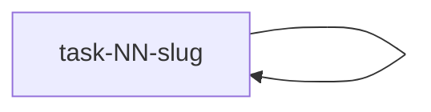

# {Goal name} — Plan

## Goal

{The major goal this plan reaches: what must be true when every task below is done, and who uses the result.}

## Design

{Link to the Ideation result, or to the caller's topic contract when Ideation did not run. Do not restate it.}

## Task Graph

{One edge `A --> B` for each task B that uses task A's result. Show every task in this plan as a node, and
keep a task from another plan document under its own ID. Tasks with no path between them may run in parallel.}

## Tasks

### `task-NN-slug` — {Task title}

#### Goal

{What must be true when this task is done, and how a reviewer can tell. Add a number only when the user, an
accepted decision, or a project rule requires it, and name that source.}

#### Context

{Why this task exists and what the developer cannot find alone: decisions already made and the state it starts
from.}

#### Constraints

- {A rule that must hold}: {its reason and source}

{Leave this section out when nothing must hold beyond the Goal.}

#### Taste and Preference

- {A leaning, with its source or exemplar}

{Leave this section out when none is known.}

{Repeat the task block for each task in this goal.}
